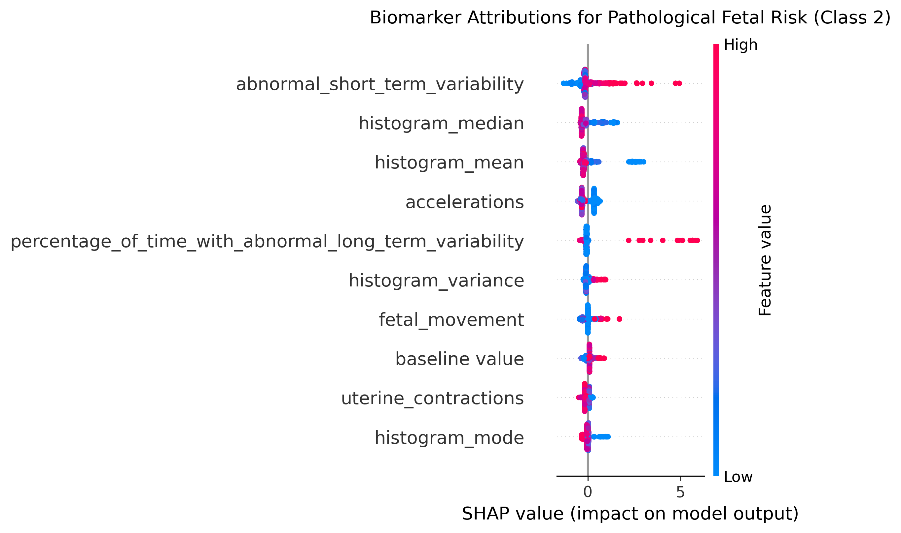

# Fetal Distress Risk Stratification from Cardiotocography

Explainable three-tier fetal risk stratification (Normal / Suspect / Pathological) from 21 cardiotocography (CTG) features, using class-weighted LightGBM with stratified 5-fold cross-validation and SHAP attribution analysis.

## Results

Out-of-fold evaluation on 2,126 CTG recordings (5-fold stratified CV, seed 42):

| Class | Precision | Recall | F1 | Support |
|---|---|---|---|---|
| Normal | 0.9782 | 0.9480 | 0.9629 | 1655 |
| Suspect | 0.7765 | 0.8949 | 0.8315 | 295 |
| Pathological | 0.9011 | 0.9318 | 0.9162 | 176 |
| **Macro avg** | 0.8852 | 0.9249 | 0.9035 | 2126 |

- Accuracy: **0.9393**
- Macro one-vs-rest ROC-AUC: **0.9854**

> These figures come from the original notebook (`notebooks/01_distress_risk_stratification.ipynb`). The script version computes class weights inside each fold, so numbers may differ in the third decimal place.

### Explainability: drivers of Pathological risk



The dominant risk drivers are high `abnormal_short_term_variability` and high `percentage_of_time_with_abnormal_long_term_variability`, while low `histogram_mean`, `histogram_median` and `accelerations` push predictions toward the Pathological tier. This is consistent with clinical CTG interpretation, where reduced variability and absent accelerations are recognised markers of fetal compromise.

## Repository structure

```
fetal-distress-risk-stratification/
├── configs/
│   └── default.yaml          # all hyperparameters and paths
├── data/
│   └── README.md             # how to obtain the dataset (CSV not committed)
├── notebooks/
│   └── 01_distress_risk_stratification.ipynb   # original exploratory notebook
├── results/
│   ├── figures/              # SHAP and confusion matrix plots
│   └── metrics.json          # written by the pipeline
├── scripts/
│   └── run_pipeline.py       # end-to-end CLI entry point
├── src/fetal_risk/
│   ├── data.py               # loading and label encoding
│   ├── train.py              # stratified CV training loop
│   ├── evaluate.py           # metrics, report, confusion matrix
│   └── explain.py            # SHAP computation and plots
├── tests/
│   └── test_pipeline.py      # synthetic-data smoke tests
├── requirements.txt
├── LICENSE
└── README.md
```

## Quickstart

```bash
git clone https://github.com/<your-username>/fetal-distress-risk-stratification.git
cd fetal-distress-risk-stratification
python -m venv .venv && source .venv/bin/activate
pip install -r requirements.txt

# place fetal_health.csv in data/raw/ (see data/README.md)
python scripts/run_pipeline.py --config configs/default.yaml
```

Outputs are written to `results/`. To reproduce the notebook's last-fold SHAP plot exactly, set `explain.scope: last_fold` in the config.

Run tests:

```bash
pytest -q
```

## Method

1. **Data**: 2,126 CTG recordings with 21 features, labelled by expert obstetricians into three classes (77.8% Normal, 13.9% Suspect, 8.3% Pathological).
2. **Validation**: stratified 5-fold CV; all metrics are out-of-fold.
3. **Imbalance handling**: balanced class weights (inverse class frequency) to penalise missed Suspect and Pathological cases.
4. **Model**: LightGBM, 180 trees, learning rate 0.04, max depth 4.
5. **Explainability**: TreeSHAP on the Pathological class. By default the pipeline explains every recording with the fold model that did not see it, giving full-cohort attributions rather than a single fold.

## Dataset

Ayres-de-Campos, D., Bernardes, J., Garrido, A., Marques-de-Sá, J., & Pereira-Leite, L. (2000). SisPorto 2.0: A program for automated analysis of cardiotocograms. *Journal of Maternal-Fetal Medicine*, 9(5), 311-318.

Kaggle mirror: [Fetal Health Classification](https://www.kaggle.com/datasets/andrewmvd/fetal-health-classification). Original source: [UCI Cardiotocography](https://archive.ics.uci.edu/dataset/193/cardiotocography).

## Limitations

- Single-centre retrospective dataset; no external validation cohort.
- Features are pre-extracted CTG summary statistics, not raw FHR signals.
- Model outputs are research results and are not validated for clinical decision-making.

## Citation

```bibtex
@misc{zaman2026fetalrisk,
  author = {Zaman, Faiza Binte},
  title  = {Fetal Distress Risk Stratification from Cardiotocography},
  year   = {2026},
  url    = {https://github.com/<your-username>/fetal-distress-risk-stratification}
}
```

## License

MIT. See [LICENSE](LICENSE).
